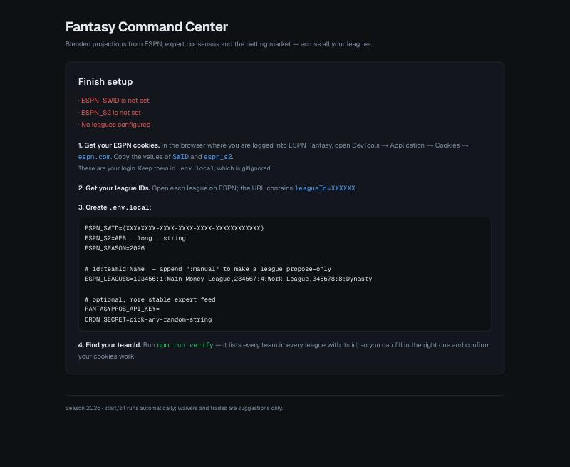

# Fantasy Command Center


*The first-run setup screen. The dashboard itself shows personal league data, so no screenshot of it is published.*

Tracks all your ESPN fantasy football leagues, **sets your start/sit automatically**,
and proposes waiver pickups and trades.

Start/sit decisions are not ESPN's projections. They blend:

| Source | What it contributes |
|---|---|
| **FantasyPros ECR** | Expert consensus rank + how much the experts disagree |
| **ESPN projections** | Baseline, in your league's exact scoring |
| **Sleeper market** | Independent injury/market rank across millions of leagues |
| **Vegas lines** | Implied team total for each game — the matchup signal |
| **Your league** | Real slot rules, scoring, byes, and kickoff locks |

Season averages are shrunk toward projection by sample size — early in the year a
"season average" is one game, and a single 30-point outing would otherwise make a
waiver-wire body look like a star and wreck every trade valuation.

Expert ranks are ordinal and projections are cardinal, so they can't be averaged
directly. Each position's expert ordering is mapped onto that position's ESPN
point curve, which puts both on your league's scoring scale — a disagreement then
shows up as a point difference you can act on.

## Setup (about 3 minutes)

**1. Get your ESPN cookies.** In a browser logged into ESPN Fantasy, open
DevTools → Application → Cookies → `espn.com`. Copy `SWID` and `espn_s2`.
These are your login — they live only in `.env.local`, which is gitignored.

**2. Get your league IDs.** Open each league on ESPN; the URL contains `leagueId=XXXXXX`.

**3. Create `.env.local`** (copy `.env.example`):

```
ESPN_SWID={XXXXXXXX-XXXX-XXXX-XXXX-XXXXXXXXXXXX}
ESPN_S2=AEB...
ESPN_LEAGUES=123456:1:Main League,234567:4:Work League,345678:8:Dynasty
```

Each entry is `leagueId:teamId:Label`. Don't know your `teamId`? Put anything and run step 4 — it prints every team id in every league.

**4. Verify.**

```bash
npm run verify
```

Confirms your cookies work, lists all teams so you can fix your `teamId`, and
reports which expert sources are reachable.

**5. See what it would do, without touching anything.**

```bash
npm run lineup:dry
```

**6. Validate the write path — once.**

ESPN's write endpoint is undocumented, so the first live write is deliberately
restricted to one league you watch:

```bash
npm run lineup -- --league 123456 --confirm
```

It submits the changes, reads your roster back from ESPN, and confirms each
player actually landed in the right slot. On success, automation unlocks.

Until that succeeds, `npm run lineup` and the scheduler refuse to run — so a
wrong request can never hit all three of your real leagues unattended.

**If that write fails with a 4xx**, ESPN has changed its transaction format. Get
the ground truth in 30 seconds: open ESPN Fantasy in your browser, DevTools →
Network, make any bench/start swap by hand, and look at the `transactions` POST.
Its URL, headers and JSON body are exactly what `setLineup()` in
[`lib/espn/client.ts`](lib/espn/client.ts) needs to match.

**7. Go live.**

```bash
npm run lineup
```

## Daily use

```bash
open "$HOME/Desktop/Fantasy Command Center.app"   # the dashboard, always running
npm run dev          # dev server with hot reload, at http://localhost:3001
npm run report       # full briefing for all leagues in the terminal
npm run lineup:dry   # preview start/sit changes
npm run lineup       # apply start/sit to ESPN, then verify it stuck
npm run scorecard    # did the auto-lineup actually help?
npm run edge         # win probability, playoff odds, opponent weaknesses
npm run learn        # grade past predictions and refit the model
npm run doctor       # check every data source, alert if something broke
npm run selftest     # engine tests, no network or credentials needed
npm run dashboard:restart   # pick up a code change in the always-on dashboard
```

The dashboard runs as a launchd agent on `127.0.0.1:3000`, so clicking the app
icon only opens it. `npm run dev` uses port 3001 to stay out of its way.

## One-click waivers and trades

In the dashboard, every waiver target has a **Claim** / **Add** button and every
trade idea has **Send offer**. Both take two clicks — the second is an explicit
confirmation showing exactly who you're adding, who you're dropping, and what
the other manager will see.

- **Waivers vs. free agents are different transactions.** The app reads each
  player's live status and sends the right one.
- **In a FAAB league every add is a sealed bid.** You commit a number and only
  find out at processing whether someone outbid you, so the app always quotes a
  real bid — never "free, just claim him." It sizes the bid off how much the
  player improves your startable lineup, scaled by budget left and weeks
  remaining ($20 in week 3 is a very different bid from $20 in week 13), and
  bumps anyone genuinely useful a dollar above the floor so you don't lose him
  on a tie. Redline is FAAB; Meyer Den and Multiple Mossy's use rolling priority,
  where no bid box appears.
- **You pick who to drop.** Each target has a roster dropdown, defaulted to the
  least valuable player you can spare. When your roster is full the drop is
  mandatory and the button stays disabled until you choose one — ESPN answers
  409 Conflict on a full-roster add with nothing dropped, and says nothing about
  why.
- **A drop is irreversible, so the server can refuse it.** Protection is relative
  to your own roster, not league-wide ownership: a top-40 player is never a
  routine cut, and otherwise the bottom quarter of your roster is always fair
  game. An absolute ownership threshold does not work — in a 6-team league only
  ~96 players are rostered anywhere, so every roster spot is 90%+ owned and an
  absolute rule locks the whole team. Overriding a warning takes a second
  deliberate click, and the guard lives in the write path, not just the UI.
- **Every add names its casualty.** No add on a full roster is free, so each
  target shows exactly who goes, in the dashboard and in `npm run report`.
- **Waiver value is net of the drop, including what the drop costs your depth.**
  Weekly points alone say a bench receiver is free to cut. He is not: he covers a
  bye, he is the insurance if a starter goes down, and he may be the last body
  eligible for a thin slot. Dropping your only kicker carries a 14-point penalty
  and a warning that you cannot fill K; dropping a fourth receiver off a deep
  roster carries none. Targets that do not beat what you give up are shown and
  labelled "not worth the drop" rather than quietly ranked first.
- **Verification differs by type.** A free-agent add is confirmed by reading your
  roster back. A waiver claim is confirmed by finding it in pending transactions
  (it won't hit your roster until the waiver run). A trade proposal changes
  neither roster, so it's confirmed against the league's pending-transaction list
  — never from a bare 200.

## Bye-week lookahead

The dashboard and `npm run report` warn about upcoming byes that break your
lineup — not just who's off, but whether you can still field a legal starter at
every slot. The week you notice a bye is the week it's too late: the replacement
you needed cleared waivers seven days earlier.

It stays quiet unless something is actually actionable — a slot you can't fill,
a thin replacement, or three-plus starters out at once.

## Incoming trade offers

Offers other managers send you appear at the top of the dashboard, scored by the
same engine, with an accept / decline / close-call verdict. They're scored by how
much your *startable lineup* improves — not by adding up player values, which
flatters every 2-for-1 by crediting you for a player you have no slot to start.

Accepting still happens on ESPN; the app tells you whether it's worth it.

## Winning, not scoring

`npm run edge` (and the dashboard) answers the question that actually matters.

**Win probability, not projected points.** A head-to-head league pays the same
for a one-point win as a forty-point win, so the lineup that scores most is not
always the lineup most likely to win. Each side's lineup gets a mean and a
standard deviation, and the matchup is resolved as a normal approximation.

**Deliberate variance.** Position volatility is modelled from measured
coefficients of variation — QB 0.36, RB 0.54, WR 0.58, TE 0.63 (Underdog Network
best-ball study); K and D/ST are estimates. When you are an underdog a
boom-or-bust starter with a lower mean but a fatter tail genuinely raises your
odds: in the test suite a 20-point underdog goes from 7.9% to 26.4% by adding
volatility. The research is equally clear that this must be *deliberate* —
randomly adding volatility does not help, and every extra boom/bust starter costs
a favourite win probability — so a swap is only ever suggested when win
probability actually improves.

**Playoff and title odds.** 20,000 Monte Carlo seasons over your real remaining
schedule, using each team's own startable lineup, with this league's seeding
tiebreak. It also reports what this week is worth in playoff probability, so you
can tell a must-win from a formality. Where every team makes the bracket, it
switches to projected seed and first-round-bye odds, because qualifying is not
the goal there.

## Reading your leaguemates

`npm run edge` scans every other roster for holes (a starter well below the
league average at his slot), surplus (bench players who do not crack their own
lineup), injuries, and record-driven desperation — then finds trades where they
gain real lineup points while you gain more real value.

Value is **over replacement, by position**. Raw points are not comparable across
positions and produce confidently terrible trades: a 20-point quarterback looks
better than a 12-point tight end until you notice the waiver wire has an
18-point quarterback and a 5-point tight end. It also discounts players *your*
roster cannot start — a third quarterback has real value in the abstract and
almost none to a team that starts one.

Each idea comes with why they would accept, why you want it, and a plainly
worded message you can copy. The pitch states the genuine benefit to them; it
does not misrepresent anything.

## It calibrates itself

Every projection is written to a journal **before kickoff**. Once a week is
settled, `npm run learn` grades those predictions against what players actually
scored and refits the model. This runs automatically every Tuesday at 9am.

Only parameters that can be checked against reality are fitted:

| Parameter | Default | What the data decides |
|---|---|---|
| Expert vs ESPN weight | 55% expert | Which source was actually closer |
| Betting-line strength | 0.35 | How much the line really moved outcomes |
| Per-position bias | none | Whether a position is systematically over-projected |
| Position volatility | published CVs | What these leagues actually produce |

**Fitted values are shrunk toward the defaults by sample size**, the same way
season averages are shrunk toward projections early in the year. With two weeks
of football any "learned" parameter is mostly noise, so the model moves a little
on a little evidence and a lot on a lot. Below about 60 graded predictions it
changes nothing at all and says so.

**A fit that does not beat the defaults is thrown away.** Accuracy is measured
by holding out one week at a time, fitting on the rest and scoring the week the
weights never saw. Refitting and then scoring on the same rows always flatters
the fit — the expert weight is literally chosen by minimising error on them — so
the in-sample number cannot answer "would this have helped next week?". Both
numbers come from the same predictor with only the parameters swapped, which the
earlier version did not do: it compared a full projection against a cruder one
with no betting line applied, and so reported "no improvement" even where the
fit was strictly better. If the held-out error does not improve, the defaults
are kept and the reason is printed.

**Each prediction is frozen at that player's own kickoff.** A lineup runs five
times a week; the journal keeps the last projection taken before a given player
plays, and never touches his row after that. It used to overwrite the whole
week on every run, so the snapshot that survived was Monday afternoon's — taken
after most of the slate had been played, from expert ranks and an injury report
that had already seen the result, with finished games carrying no betting line
left to record. Those rows graded the model generously and made the betting
weight impossible to fit.

The fitting is verified in the test suite against data with a known answer: it
learns to trust the experts when they are right (0.55 → 0.85), to distrust them
when ESPN is right (0.55 → 0.18), to spot a systematically over-projected
position, and — importantly — to leave itself alone on a tiny sample.

The prediction is recorded before the outcome is known on purpose. Recomputing a
projection after the fact would quietly use updated inputs and make the model
look better than it was.

## It tells you when something breaks

The app **fails open** on purpose: if the expert feed disappears, lineups still
get set on ESPN plus market data rather than not being set at all. That is the
right behaviour and also the dangerous one — a broken source is invisible, and
you would keep getting slightly worse lineups every week without noticing.

So every run records the health of each subsystem, and a change in that health
raises a macOS notification:

| Watched | Severity | Alerts after |
|---|---|---|
| ESPN login expired | critical | 1 failure |
| Every projection reading zero | critical | 1 failure |
| Lineup write rejected | critical | 1 failure |
| Expert consensus unavailable | degraded | 2 consecutive |
| NFL schedule / betting lines | degraded | 2 consecutive |
| Sleeper market data | minor | 3 consecutive |
| Scheduler gone quiet (96h) | — | weekly check |
| Calibration stops improving accuracy | — | weekly check |

It alerts on **transitions, not occurrences**: one alert when a source goes down,
silence while it is still down, one more when it recovers. An alert that repeats
every run is one you learn to ignore.

A daily check at 10am catches a source that breaks on a day with no games, and
`npm run doctor` runs the whole thing on demand. Anything wrong also appears as a
banner at the top of the dashboard.

## Did it help?

The dashboard has a scorecard, and `npm run scorecard` prints the same thing.
Every change the auto-lineup makes is logged, then graded against what the
players actually scored — the points the guy it started put up versus the points
the guy it benched put up.

Projections are easy to trust and easy to be wrong about. This is the only view
that tells you whether following them worked. Unplayed games stay blank rather
than being counted as zeros, because before kickoff "scored 0" and "hasn't played"
look identical in ESPN's data.

## Automation

Start/sit runs automatically. **Waivers and trades never fire on their own** —
they only ever happen on a click you make.

```bash
bash scripts/install-schedule.sh
```

Installs four macOS launchd jobs:

- **lineups** — Thu 3:30pm · Sat 9:00pm · Sun 5:15am · Sun 8:45am · Mon 3:30pm
- **learning** — Tue 9:00am, grades last week and refits
- **health** — daily 10:00am, alerts if a data source broke
- **dashboard** — always on, serving `http://127.0.0.1:3000`

Logs to `data/logs/`, except the dashboard's, which go to
`~/Library/Logs/FantasyCommandCenter/app.log`. Remove everything with
`bash scripts/install-schedule.sh remove`.

The dashboard is a launchd job rather than something the app icon starts. It
used to be the latter — `nohup npm run start &` from inside the bundle — and
clicking the icon stopped working: the server was gone moments later and
repeated clicks did nothing at all. The project sits on the Desktop, which is an
iCloud-synced, TCC-protected folder that a launchd job has no access to by
default, and that produces two silent failures worth knowing about if you move
this project: logs written inside the folder make the job die with `EX_CONFIG`
before it runs, and `/bin/bash` as a program cannot read its own script there
("Operation not permitted", exit 126). The Homebrew `node` binary does have
access, which is why every job here is run by `node` and why only the
dashboard's logs live outside the project.

It binds to loopback, not `0.0.0.0`. The API can set a lineup, claim a waiver
and propose a trade without authenticating, so an always-on server must not be
reachable from the rest of the network.

Every run lands *before* the kickoffs it is trying to optimise, because a
player's slot locks the moment his own game starts — a run even fifteen minutes
late cannot move the players who matter most in that window. On Pacific time
that means Thursday night kicks at 5:15pm, the Sunday main slate at 10:00am,
London games as early as 6:30am, and Monday night at 5:15pm. If you are in a
different timezone, shift the times so each still sits at least an hour before
the earliest kickoff in its window.

To make one league propose-only, append `:manual` to its entry:
`ESPN_LEAGUES=123456:1:Main League,234567:4:Work:manual`

## Safety

- Write gates are per transaction type. A verified lineup write does not unlock
  add/drops or trades — each path earns its own first confirmed success.
- The first live lineup write is gated to a single supervised league; multi-league
  automation stays locked until ESPN confirms one succeeded.
- Valuable players are protected from accidental drops at the write layer.
- Every write is read back from ESPN and verified; the run fails loudly if a move didn't stick.
- If a write fails, the run halts instead of repeating a broken request against your other leagues.
- Players whose game already kicked off are frozen — never moved, never counted on.
- Bye-week and OUT players are never started.
- `--dry-run` prints the exact transaction without sending it.
- Waivers and trades never execute.

## Deploying (optional)

`vercel.json` has the cron schedule. When deployed, configure leagues through the
`ESPN_LEAGUES` env var and set `CRON_SECRET` so the endpoint isn't publicly runnable.

## Caveats

- ESPN's fantasy API is undocumented. If a shape changes, `npm run verify` tells you which part broke.
- `espn_s2` expires periodically; re-copy it when `verify` reports a 401.
- Without `FANTASYPROS_API_KEY` the expert feed is scraped, which is more fragile.
  The app degrades to ESPN + Sleeper + Vegas and says so rather than failing.
